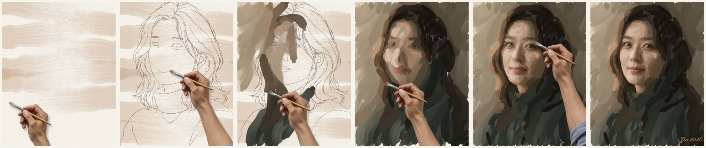

# 油画肖像模式（实验室 · v1）

照着一张照片，像真人画家那样一笔一笔画出油画肖像，并输出带手、画笔和调色盘的过程视频。这个方向延续了 v3 的 line-first 引擎：先起稿，再上色。起稿直接复用引擎的 `extract_strokes` / `classify` / `order`。



## 流程

铺底色 → 起稿（线稿逐笔，先外形后五官）→ 铺大色 → 塑形 → 深入刻画 → 细节 → 点睛 → 落款

- **笔触**：榛形笔的弯曲笔触，沿结构张量流场走；起笔落下，收笔抬起变细。有刷毛纹，颜料用完会出现干笔飞白，会带起底下的湿颜料，有厚涂肌理和亚麻画布纹理。
- **顺序**：按区域画；区域内先暗后亮，同一种颜色连着画（最近邻路线，允许来回走笔）。细节只加在焦点区域（脸、眼、嘴、鼻）。
- **点睛**：从照片里读出瞳孔和高光的位置，用一次深色、一次亮色，接近真速点上去。
- **视频**：一只握着油画笔的手，笔毛沾着当前的颜色。新调的颜色抹在调色盘上，参考照片贴在画布下方。每一遍从约 2× 起步再加速；手抬起长距离移动时，每帧最多走 240 px。

## 运行

```bash
PY=~/.local/share/sweety-handdraw-video/venv/bin/python     # 需要 numpy / scipy / Pillow，以及 ffmpeg
FOCUS='[[0.41,0.37,0.16,0.17,0.85],[0.42,0.42,0.36,0.34,0.5],[0.335,0.296,0.05,0.025,1.0],[0.512,0.305,0.05,0.025,1.0],[0.40,0.461,0.07,0.03,1.0],[0.39,0.38,0.04,0.045,0.95]]'
$PY paint.py plan src/subject.png src/sketch.png ../../output/oil/run "$FOCUS" '["Leo 2026", [880, 1318, 230, 70]]' '[[0.339,0.297,0.045,0.026],[0.513,0.306,0.045,0.026]]'
$PY film.py ../../output/oil/run --stills 1
```

- 焦点椭圆是 `[cx, cy, rx, ry, 权重]`，眼睛是 `[cx, cy, rx, ry]`，都按画布比例（0–1）写。
- 素材（照片、对齐的起稿线稿、握笔手）是用 Codex CLI 图像通道生成的，提示词在 `prompts/`。照片中是虚构人物。

## v1 指标

- 视频 62.9 s，1280×1920，30 fps。
- 笔数：起稿 301 · 铺大色 144 · 塑形 213 · 刻画 253 · 细节 280 · 点睛 126 · 落款 13。
- 手每帧移动的距离：中位 90 px，p99 441 px。

## 局限

焦点和眼睛的位置是人工标的。终稿是松动的写生风格，后续优化在本分支继续。
