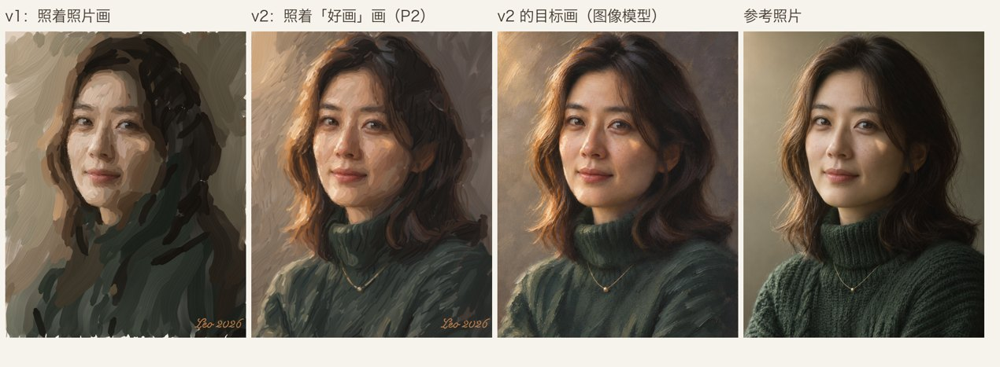

# 油画肖像模式（实验室 · v1）

照着一张照片，像真人画家那样一笔一笔画出油画肖像，并输出带手、画笔和调色盘的过程视频。这个方向延续了 v3 的 line-first 引擎：先起稿，再上色。起稿直接复用引擎的 `extract_strokes` / `classify` / `order`。


## 流程

铺底色 → 起稿（线稿逐笔，先外形后五官）→ 铺大色 → 塑形 → 深入刻画 → 细节 → 点睛 → 落款

- **笔触**：榛形笔的弯曲笔触，沿结构张量流场走；起笔落下，收笔抬起变细。有刷毛纹，颜料用完会出现干笔飞白，会带起底下的湿颜料，有厚涂肌理和亚麻画布纹理。
- **顺序**：按区域画；区域内先暗后亮，同一种颜色连着画（最近邻路线，允许来回走笔）。细节只加在焦点区域（脸、眼、嘴、鼻）。
- **点睛**：从照片里读出瞳孔和高光的位置，用一次深色、一次亮色，接近真速点上去。
- **视频**：一只握着油画笔的手，笔毛沾着当前的颜色。新调的颜色抹在调色盘上，参考照片贴在画布下方。每一遍从约 2× 起步再加速；手抬起长距离移动时，每帧最多走 240 px。

## 运行

```bash
PY=~/.local/share/sweety-handdraw-video/venv/bin/python     # 需要 numpy / scipy / Pillow，以及 ffmpeg
FOCUS='[[0.41,0.37,0.16,0.17,0.85],[0.42,0.42,0.36,0.34,0.5],[0.335,0.296,0.05,0.025,1.0],[0.512,0.305,0.05,0.025,1.0],[0.40,0.461,0.07,0.03,1.0],[0.39,0.38,0.04,0.045,0.95]]'
$PY paint.py plan src/subject.png src/sketch.png ../../output/oil/run "$FOCUS" '["Leo 2026", [880, 1318, 230, 70]]' '[[0.339,0.297,0.045,0.026],[0.513,0.306,0.045,0.026]]'
$PY film.py ../../output/oil/run --stills 1
```

- 焦点椭圆是 `[cx, cy, rx, ry, 权重]`，眼睛是 `[cx, cy, rx, ry]`，都按画布比例（0–1）写。
- 素材（照片、对齐的起稿线稿、握笔手）是用 Codex CLI 图像通道生成的，提示词在 `prompts/`。照片中是虚构人物。

## v1 指标

- 视频 62.9 s，1280×1920，30 fps。
- 笔数：起稿 301 · 铺大色 144 · 塑形 213 · 刻画 253 · 细节 280 · 点睛 126 · 落款 13。
- 手每帧移动的距离：中位 90 px，p99 441 px。

## v2：向一幅「好画」画（P2 路线）



v1 的笔触瞄准照片。引擎不懂艺术取舍（哪里虚、哪里实，明暗怎么组织，暖光冷影，头发怎么概括），所以终稿只是一张松动的写生。

v2 分两步：
1. 先让图像模型把照片画成一幅和照片逐像素对齐的大师级写实油画，作为目标（`prompts/target-a.txt`，生成时附上照片作参考）。
2. 引擎仍然一笔一笔画，只是瞄准这幅目标。焦点、眼睛位置和起稿线稿都和照片对齐，直接沿用。

画法上的改进（`--style v2`）：
- **薄暗厚亮**：厚涂肌理随颜料明度增加。
- **边缘有虚实**：形体平缓转折处的笔触边缘柔，结构边缘的笔触保持锐。
- **柔化（新的一遍）**：用干净的笔顺着形体扫，只带动画布上已有的颜料，不加新色。脸部用小笔，背景用大笔。
- **头发和衣服的纹理遍（新的一遍）**：细长笔触顺流场走，只在颜色变化处断笔，起笔和收笔都尖。
- **整张画都细化**：焦点权重下限从 0.12 提高到 0.35，后面几遍也会照顾头发、衣服和背景。
- **画到画布边缘**：笔触可以出界。
- **块面颜色更准**：铺大色时笔触颜色更多保留自身颜色，背景少了色块斑驳。
- **收笔多样**：有的提笔变尖，有的直接停住。

和目标对比的指标（`metric.py TARGET PAINTING...`；ΔE76 在 2 px 模糊下计算；中频对比比值是「我们 / 目标」，1.0 为一致）：

| | 脸 ΔE | 头发和衣服 ΔE | 背景 ΔE | 头发和衣服 1–4 px 对比 | 背景 4–12 px 对比 |
|---|---|---|---|---|---|
| v2（初版） | 3.0 | 5.3 | 7.0 | 0.63 | 1.86 |
| v2e | 2.9 | 3.2 | 4.3 | 0.92 | 1.39 |

运行 v2：

```bash
$PY paint.py plan TARGET.png src/sketch.png OUT "$FOCUS" '["Leo 2026", [880, 1318, 230, 70]]' "$EYES" --photo src/subject.png --style v2
```

## 换一张照片

每张照片要准备：
1. 裁成 2:3，作为 1024×1536 的 `subject.png`。
2. 生成两张图，都要附上照片作参考：一张对齐的起稿线稿，一张目标油画。提示词照 `prompts/` 改，把这张照片里的特征写进去（衣服花纹、眼镜、手等）。
3. 看图标出焦点区域、眼睛、脸和整个人物的椭圆。

人物在画面上方时加 `--crop-top 0`，让画布的 4:5 窗口从顶部开始取。签名放在画面空白处，不要压在人物上。

```bash
$PY paint.py plan target.png sketch.png OUT "$FOCUS" '["Leo 2026", [870, 60, 230, 70]]' "$EYES" \
    --photo subject.png --style v2 --crop-top 0 --face '[0.53,0.24,0.17,0.16]' --figure '[0.52,0.6,0.46,0.6]'
```

## v3：皮肤细腻、五官勾勒、视觉重点按真速画

这一轮回应用户的三条反馈：
1. 眼睛像是突然出现的；
2. 成品品质还能再提高吗；
3. 皮肤不够细腻。

画法：
- **皮肤**用单独的介质 `oil_skin`：湿画法，带起底层颜料多，刷毛纹和厚涂都弱，笔触边缘偏柔；颜色几乎完全取目标色。从塑形开始，脸上的笔触就切换成这种画法。皮肤上还有两遍「柔化」：一遍在塑形之后，一遍在细节之后。按格网扫描，每一笔带一点目标色，相当于画家用干净的笔把过渡揉开。
- **铺大色**变薄（厚涂肌理 0.55 → 0.3）。这样后面的柔化不会被底层的厚颜料棱推出接缝。
- **五官**（眼、嘴、眼镜）用柔圆笔 `oil_detail`，起笔阈值更低，颜色更准。每一遍里，五官都留到最后画，一个部位画完再画下一个。
- **勾勒（新）**：起稿线中落在「清晰五官」（焦点权重 1.0：眼睛、嘴唇、眼镜）里的线，吸附到目标画中最暗的那条线上，用目标色画成一条干脆的细线。线宽从目标画里量。动笔前先沿线两侧各压一笔周围的颜色，清掉之前的点触，这一步叫「切边」。长线分成约 70 px 一段来画，每段重新蘸颜料。鼻子（权重 0.95）是柔边，不勾线。
- **顺序**：细节 → 柔化 → 细节（小点触）→ 勾勒 → 点睛（瞳孔、眼神光）→ 落款。干脆的线和眼神光放在最上层。

视频：
- **视觉重点按真速画**：眼睛的精修笔触、勾勒线、点睛都是 1×。其余五官从 3× 起，每遍最多占 8 s。第一轮细节在 5× 起，同样受这个上限约束。切边按其余五官的速度走。
- **镜头推近**：画五官时镜头推到脸部，放大 2×，缓入缓出各 1 s，并跟随笔尖略微移动。相隔不到 10 s 的五官段合成一个连续的特写。水印在推镜头之后再叠，所以始终固定在画面上。

结果：
- 皮肤色差 4.4 → 3.1（s4）、4.7 → 3.7（s5）。
- 皮肤粗糙度：原来是目标的 1.60 / 1.03 倍，现在是 0.76 / 0.72 倍。
- 眼镜框从一串点变成连续的细线。
- 成片约 140 s，其中约 80 s 是脸部特写。

## 干擦：胡茬和皮肤纹理（2026-11-10）

一张带胡茬的男性肖像暴露了两个问题：
1. **胡茬被柔化抹掉。** 皮肤的柔化本来就是要把过渡揉开，胡茬是细碎的深色点，跟着被抹成了一片光滑的粉色，下巴显得年轻、虚胖。
2. **牙齿被勾了黑线。** 笑口露齿时，起稿里有牙齿轮廓，勾勒就沿着它画了一圈深色线，像漫画。画家不会勾牙齿。

做法：
- 新增「干擦」遍（`--texture '[cx, cy, rx, ry]'`，人工标出要保留纹理的皮肤，如胡茬区）。在柔化之后，用几乎干的笔在这块皮肤上点短笔，颜色取目标画里的细节色，只落在画布纹的凸起上。只加深不提亮：胡茬比周围皮肤暗；提亮的点看起来像麻点。
- 没有 `--texture` 时这一遍不出现，旧照片的结果不变。
- **露齿的笑口按柔边画（焦点权重 0.95），不勾线。** 抿嘴的唇线仍然可以用 1.0。

自动识别胡茬试过，不可行：按纹理强度找，会连目标画额头上的笔触一起找出来；按低饱和找，也找不准下巴。所以和焦点、眼睛一样，先人工标。

## 换手（2026-11-10）

`film.py --hand src/hand-tang-red.png` 换一只握笔的手。素材旁边的同名 `.json` 写笔尖位置和缩放，例如 `{"nib": [47.3, 31.9], "scale": 0.7}`；没有这个文件时，沿用老素材的数值。
- `hand-brush.png`：默认的男画家手，灰蓝亚麻衬衫。
- `hand-tang-red.png`：唐代女官风格的手，原创设计，不照搬任何游戏或影视形象。石榴红窄袖外罩浅杏色轻纱宽袖，袖缘有金线缠枝纹，戴细金镯。提示词在 `prompts/hand-tang-red.txt`。

素材要求：
- 衣袖只能从底边出画，左右两侧都不能碰到素材边缘，否则成片里会露出一道竖直的切口。
- 视频会把衣袖向下续长：取底边以上几百行衣料，上下镜像往复着接下去，再拉到续长后的轮廓上。原来的做法是重复底边那一行，再叠上正弦褶皱，在不透明的棉布上还过得去，在半透明的纱上会变成格子布。
- 笔尖位置沿笔毛主轴取末端往里 4 px。对老素材用同样的方法算，结果和原来人工标的 (44, 42) 一致。

## v4：块面写生（2026-11-10）

用户给了一段真人画家的写生视频（57 s）和五张成品图，作为要达到的效果。视频的关键在**顺序**：
1. 在调好灰底的画布上，先用几根线起稿；
2. 先画脸：一笔就是一个平整的色面，边缘清楚，先暗后亮，几十笔拼出形体；
3. 再画头发：几大块深色；
4. 五官初步交代；
5. 衣服：几笔宽大的笔触；
6. 背景：最后画，沿着人物轮廓往回切；
7. 推近到脸部做最后的刻画，然后签名。

每一块基本画完才换下一块，没轮到的地方一直是空白画布和起稿线。所以看起来是人在画，而不是一张图逐渐变清楚。v3 先把整张铺满，再整体加细，正好相反。

v4 的做法（`--style v4`，代码在 `planes.py`）：
- **分区**：皮肤、头发、衣服、背景。最好的办法是让图像模型画一张和照片对齐的四色分区图（`--areas`，提示词在 `prompts/areas.txt`）。没有分区图时按颜色猜，背景素净、头发深色的照片够用，但花裙子和红棕色头发会被当成皮肤。
- **块面笔触** `plane_strokes`：在一个分区里把目标画的颜色量化成几组，每个连通的色块是一个面，用平行的扁笔直笔触铺满。笔触方向跟着目标画自己的笔触方向，笔宽不超过这个面的宽度（不然耳环会被大笔盖掉）。笔触伸出本区时停在边缘并提笔收细，否则方头会沿着轮廓叠成台阶。新介质 `flat`：方头扁笔。
- **顺序**：起稿 → 脸部块面（大，再小）→ 头发（块面 + 发丝）→ 五官 → 衣服（块面 + 顺形的弯笔触 + 小笔细节）→ 背景（大块面 + 小块面 + 沿轮廓切边）→ 深入（脸部小块面、五官精修、干擦、勾勒、点睛）→ 落款。
- **底色**：画布事先调成浅暖灰，不再有铺底色那一遍。
- **节奏**：每一遍的视频时长写在 plan.json 里。眼睛最后一段（精修 7 s、勾勒 6 s）按真实速度，之前的眼睛笔触和其他五官一起 3× 起步，每遍最多 5 s。成片约 2 分钟。
- **目标画**：提示词改成块面写生：一笔一个面、笔触边缘硬朗、有限色板、暖光冷影、背景厚涂大笔触绕头部切出轮廓、衣服往下越来越稀疏。

```bash
$PY paint.py plan target.png sketch.png OUT "$FOCUS" '["Leo 2026", [x, y, w, h]]' "$EYES" \
    --photo subject.png --style v4 --crop-top 0 --face ... --figure ... --areas areas.png [--texture ...]
$PY film.py OUT --hand src/hand-tang-red.png
```

### v4.1：边缘、风格、短版（2026-11-10）

**边缘不像整体**（用户反馈，s6 左鬓角和右耳、s4 头顶右侧）：
- **分区图对不准**：分区图和目标画是分开画的，会偏几个像素，鬓角和耳朵后的头发被分进了背景，画成了灰色。现在沿每条分区边界前后 16 px，按目标画里的颜色把像素重新分给附近最像的那一区（`snap_areas`）。
- **切边那遍的光晕**：沿轮廓画背景色的切边笔触，会取到轮廓旁边被模糊、变暗的颜色，围着人画出一圈虚线光晕，人像是剪下来贴上去的。现在去掉切边，改成「收边」：在轮廓两侧用细长笔触，颜色完全取目标画（不往色堆上拉），头发丝压到背景上，背景塞到头发下面，和目标画一样。

**脸部第一遍更省笔**：笔宽 20 → 26 px，s6 从 215 笔减到 143 笔。

**五种风格**（`--preset`）：按用户给的五张样品，用文字描述风格，生成目标画，不把作品本身喂给模型，也不写在世画家的名字。提示词在 `prompts/style-*.txt`。块面那几遍的笔法跟着风格变：
- `planes` 块面写生：参考视频那种。
- `blocky` 方块笔触：横竖方块，短笔触拼贴。
- `knife` 刮刀厚涂：新介质 `knife`，平面锋利，刀边挤出颜料脊，短刀。
- `sunlit` 外光写生：圆头笔，边缘偏软，长笔触。
- `digital` 数字厚涂：新介质 `digital`，平涂，没有厚度和笔毛纹。

**短版**：`film.py --length 60`。按比例压缩每一遍的时长、五官上限、眼睛真速段、每遍开头的停顿和回调色盘的次数，直到片长约 60 秒。主线（起稿、脸、头发、衣服、背景）压得比细化的几遍少，眼睛最后几笔仍然是真速。

### v4.2：深色头发、切边、补底（2026-11-10）

s7 是一张深红棕色长直发的照片。深色块面直接画在浅色底子上，暴露了三个问题。s4 用同样的参数重画，和目标画的色差在头发、衣服、背景三区都下降（头发 14.1 → 10.8），没有退步。

- **只沾湿颜料**：笔经过的地方会把底下的颜料带起来一点。v4 从干的浅灰底子开始画，第一遍深色笔触会混进浅灰，头发块面整体亮了 35 个色阶，后面的发丝盖不全，就成了灰蓝色的刮痕。现在按底下的颜料厚度决定能带起多少，空白底子不会被带起来。铺过底色的 v1–v3 不受影响。
- **块面不出本区**：背景用长直笔沿着弧形的头发轮廓走，笔中段会拱进头发几十像素。收边那遍只管轮廓两侧 9 px，补不回来，结果是一条深色轮廓线、一道浅缝、再是头发，看起来不像一个整体。现在每个分区的块面笔触只能伸出本区 4 px，再用 4 px 渐隐，就像画家用笔锋沿着轮廓切。
- **补底**：两个块面之间太窄的色块不够一个面，原来会被跳过，变成一条露底的缝。现在这样的窄色块并到最近的块面里。每个分区的第一遍画完后，再找区内（离边缘 6 px 以上）还露底的地方，用小笔补上，最多补两轮。s7 头发里比目标亮很多的像素从 14006 减到 1545。

**标注按画布比例**：画布是 1120×1422，只取 2:3 照片上面的一部分（`--crop-top 0` 时是 1024×1536 照片的前 1300 行）。焦点、眼睛的纵向坐标要除以画布对应的高度，不能除以照片高度，否则眼睛那遍精修会落到刘海上。

## 素描（2026-11-11）

`sketch.py` 用铅笔画一张肖像，朝一幅和照片对齐的素描（图像模型画的目标画）一层层画过去。

| 步骤 | 做什么 |
|---|---|
| 起形 | 轻淡的辅助线（线稿引擎从线描里抽出的笔画），颜色永远不深过成品 |
| 铺大关系 | 头发顺着发流一根根排长线；脸的暗部用斜排线，再交叉一层；针织衣顺着罗纹；背景只有头部暗侧几片 |
| 揉擦 | 纸擦笔揉脸，纸巾顺着发流擦头发和衣服 |
| 深入 | 更细的交叉排线和发丝；脸画到成品的色调，五官的中间调也在内，只留比周围皮肤明显深的线和点 |
| 刻画五官 | 成品里的细线和留下的最深处，镜头推近，眼睛按真速 |
| 点睛 | 瞳孔最深的一点 |
| 提亮 | 橡皮笔顺着发流擦出头发的光泽，可塑橡皮点亮皮肤的亮部 |
| 收尾 | 头发、衣服、背景的最后一层，密排到成品的色调，再补一遍漏掉的小缝 |
| 签名 | 铅笔签名 |

五官的时机试了四次：留到最后画，收尾时整张脸都完成了，五官还停在浅浅一层，像贴了几块白斑；提前在椭圆标注区里整块画完，又在没画完的脸上留下几块深色椭圆；只留「比纸深很多」的地方，眼窝的阴影也算进去，被椭圆切成一片片。现在脸（连同五官的中间调）先画完，特写只补「比周围皮肤明显深」的线和点（瞳孔、睫毛线、唇线、鼻孔），特写前的五官看起来是「还没点上深色」。

做法：

- **笔**（`media.py`）：石墨只会变深；压力轻时只沾到纸纹的凸起，压力重时连凹处也填满。纸擦笔把已有的石墨揉匀，橡皮把石墨擦回纸色。
- **每层朝一张色调图画**：前几层是成品调淡、模糊后的样子，最后一层就是成品本身。每一笔落笔前先看纸上这一带现在多深，已经够深就不画。所以过程中看得到排线，结束时纸上就是那幅素描。头发的第一层朝整片头发模糊后的深色画，光泽一起盖住，之后靠橡皮顺着发流擦出来，和真人一样（第一层若只盖到成品的七八成，光泽从没被盖住，橡皮那一步只有两三笔）。
- **来回排线**：一片排线一来一回，头发一根往下、下一根往上，手不用每笔都回到起点。
- **成片里连笔**：同一片里相隔不到 90 px 的几笔，在成片里算手的一个连续动作，手不离纸，笔画在手经过时出现。原来每笔之间都要「抬手」，加上长跳转的最短时长，全片要 192 s；连笔加来回排线后是 119 s。

```bash
$PY sketch.py TARGET.png SKETCH.png AREAS.png OUT FOCUS EYES '["Leo 2026", [850, 46, 220, 66]]' \
    --photo PHOTO.png --face '[cx, cy, rx, ry]'
$PY film.py OUT        # 读到 plan.json 里 kind=sketch：纸、素描工具、拿铅笔的手
```

## 动漫插画（2026-11-11）

`anime.py` 像插画师在平板上画画：先画草稿，再描线稿，隐藏草稿，在线稿下面上色。

| 步骤 | 做什么 |
|---|---|
| 草稿 | 浅蓝色快速起稿，单独一层 |
| 线稿 | 干净的线稿，一笔一笔描，眼睛和五官按真速，镜头推近 |
| 平涂 | 草稿层隐藏；线稿下面一块一块平涂底色，每块只涂在本区内（像剪贴蒙版） |
| 阴影、高光 | 硬边的赛璐璐阴影块，然后亮部 |
| 渐变 | 喷枪软笔做腮红、发光、背景光斑，最后补齐 |
| 点睛、签名 | 眼睛的高光点在最上层 |

做法：

- **拆开成品插画**：线稿是插画里「比两侧都深的细线」（黑帽滤波）；线下面的颜色用线两侧的颜色补上；每个分区（皮肤、头发、衣服、背景，来自分区图）先按色相聚成几种「材质」（皮肤、眼白、虹膜、嘴唇……），每种材质再按明暗分出阴影和亮部。
- **线稿**：只靠滤波找到的线不完整（脸的轮廓、头发外轮廓在插画里是色块边界，不是线），描出来零零碎碎。现在用图像模型从成品画的干净线稿描外轮廓（和成品偏差不到 1 px），头发内部和虹膜里用成品自己的线（那张线稿把虹膜涂实了，眉毛画在刘海上）。
- **图层**：颜色层、草稿层、线稿层、高光层，成片里平涂开始时草稿层淡出。

```bash
$PY anime.py TARGET.png ROUGH_SKETCH.png AREAS.png OUT FOCUS EYES '["Leo 2026", [850, 46, 220, 66]]' \
    --photo PHOTO.png --face '[cx, cy, rx, ry]' --lineart LINEART.png
$PY film.py OUT        # kind=anime：颜色面板、拿手写笔的手
```

素材：`src/hand-tang-pencil.png`、`src/hand-tang-stylus.png`（同一位唐代宫廷女官的手，原创设计），`src/tools-sketch.png`（素描工具托盘）。动漫的眼睛、五官位置要在动漫成品图上另标：动漫化后眼睛变大，不能沿用照片的标注。

## 三种画法的重做（2026-11-11）

用户看完油画 v4.2、素描 v1、动漫 v1 的意见：油画笔触缺轻重和自然感，过程约 60 分，局部不完整、断断续续；素描和动漫像「擦出来的」。要求先把这三种做到位，引擎分开。动手前的盘点在 [docs/audit-2026-11-11.md](docs/audit-2026-11-11.md)。三种画法共用的验收标准：

- 笔不是窗口：一笔只有一种深浅或一个颜色，画面是很多笔叠出来的。
- 手离开一块区域时，这一块没有洞；线是一笔画完的。
- 每一处痕迹都在工具经过的那一刻、在工具下面出现；手不在帧与帧之间乱跳。
- 成品好看，人像不走样。

下面三节分别是油画 v5、素描 v2、动漫 v2。

## v5：塑形写生（2026-11-11）

用户看完 v4.2 的反馈：笔画没有轻重、深浅、不规则感；过程里局部不完整、断断续续，「不像人画的」，过程只能打 60 分。v5 保留 v4 的顺序（起稿 → 脸 → 头发 → 五官 → 衣服 → 背景 → 推近深入 → 落款），重写了「块面怎么画上去」这一层（`forms.py`，`--style v5`）。v1–v4 的代码路径没有动，v4 用同样的参数重画 s4，和原图逐像素相同。

### v4 的问题在哪

| 看到的现象 | 原因 |
|---|---|
| 脸在画的时候东一块西一块，中间留着露底的洞 | 块面按颜色一组一组画（先画所有最深的，再画次深的），不看位置 |
| 脸、头发、背景的边缘是锯齿台阶 | 笔触是笔直的方头笔，被分区图逐像素裁掉 |
| 每一笔都一样重 | 压力、含色量、长度、方向几乎是固定值 |
| 头发先画成一条条分开的「香肠」，之间露着底 | 块面细长交错，一块画完才画旁边那块 |
| 手在画头发时满画布跳 | 笔触按整幅画的行列排序，行经过脸的地方要跳过去 |

### v5 的做法

- **形体是长出来的**：一个分区里的块面按「生长前沿」画：从最深的一块开始，下一块永远是已经画好的部分旁边的那一块（深的优先，离笔近的优先）。又长又窄的块面（脸周围一圈暗部）切成几段，画完手边这一段先画它旁边的，不会先绕脸一圈。任何时候停下来，画好的部分是一整块，没画的部分是干净的底子和起稿线。
- **一块画完再走**：每块先沿轮廓切边，再填里面；每画十几笔就回头把笔触之间漏下的小缝补上，离开这一块之前再查一遍。整片画完后，分区内不留露底。
- **笔触跟着形走**：笔触沿目标画自己的笔触方向走流线（弯的），不是直尺线；允许越过块面的边界一小段（笔不会停在一条看不见的等高线上），但颜色变了就停。下一笔总是落在上一笔旁边（并优先补被颜料围住的缺口），手不再满画布跳。
- **每一笔有手感**：每一笔有自己的压力、含色量、长短和轻微的方向偏差；宽度沿笔画起伏，落笔压开、收笔提起；长笔画到后半段颜料用尽，出现干笔飞白；约三成的笔上同时带着相邻的两种色（一侧略亮）；相邻两块颜色接近的地方，偶尔用很轻的一笔把这一块拖进旁边那块（湿拖），形体转折柔和的地方边缘就虚了。
- **边缘是画出来的，不是裁出来的**：分区边界先平滑；头发和皮肤的分界改用目标画里真正的明暗边（分区图是另外画的，会偏几个像素，原来脸颊旁边会留一条「头发颜色的皮肤」）。块面碰到分区轮廓的那一段，先用小一号的笔沿着轮廓走一笔（切边），里面的笔触收在这条边里面。修正用的几遍（脸部第二遍、第三遍）不碰边缘。头发丝只能伸到目标画里确实是头发的地方，不会在脸颊边上戳出一排圆头。
- **起稿线是整根的**：线稿引擎抽出的 133 段，首尾相接、方向一致的并成一笔（102 笔），先画长轮廓，再画旁边的短线。
- **颜料只在笔下出现**：头发丝、收边、脸部细化这几遍笔数多、每笔都短。原来几笔挤在同一帧里，手在帧与帧之间乱跳，颜料像是自己冒出来的。现在这几遍笔画更宽、更少，并且相邻的笔画在成片里连成手的一个连续动作（手不离开画布，笔画在手经过时出现）。每帧落下的笔不超过两笔，都在手边。
- **脸不再越修越碎**：修正用的两遍原来有五百多笔小笔触，脸颊和额头像起了一层鳞片。现在修正笔只剩几十笔，笔更大、边缘更软、颜料更薄，只改差得多的地方，第一遍的大块面留着；块面之间的过渡靠几十笔干净的软笔拖一下（柔化）。
- **边缘是两块颜色相接，不是一条线**：分区边上最后几个像素，在目标画里已经混进了隔壁的颜色，原来沿着脸颊画出了一圈深色。现在分区边沿用「往里一点」的颜色画。头发和发丝画完以后，再沿着受光的脸颊用长笔把亮色切回去一次（只在明暗差得多的地方切，脸转进暗部的那一侧保持虚）。透过薄颜料还看得见的起稿线，在收边之前补掉。
- **提亮**：收边之后加一遍头发的亮丝（只画比画面亮的地方）。最后在特写里，额头、脸颊、鼻梁最亮的几块各用一笔厚颜料画上去（约 6 笔，按真实速度），然后才点睛。
- **眼睛**：勾勒之前用最小的笔再画一遍眼睑和虹膜边缘；眼睑线更细，线两侧的「切边」只在确实需要时才画（原来像给眼睛又描了一圈）。
- **新介质**：`bristle`（猪鬃扁笔，会干、会带起底下的湿颜料）、`bristle_flat`（修正用的小扁笔，边缘清楚）、`drag`（很轻的拖笔）。

### 结果（s7，和 v4.2 同一张目标画）

| | v4.2 | v5 |
|---|---|---|
| 和目标的色差 ΔE（皮肤 / 头发 / 衣服 / 背景） | 2.8 / 2.9 / 3.3 / 4.0 | 3.0 / 3.0 / 3.2 / 3.6 |
| 脸部修正笔数（第二遍 + 第三遍） | 529 + 236 | 45 + 41 |
| 头发第一遍：笔数，超过 200 px 的抬手跳转 | 754 笔，38 次 | 608 笔，13 次 |
| 起稿 | 133 段，跳转 28 次 | 102 笔，跳转 10 次 |
| 头发丝那一遍 | 1337 笔，约 6 笔/帧 | 1025 笔并成 427 个连续动作，约 1.6 个/帧 |
| 成片 | 125.0 s | 129.2 s |

皮肤的色差比 v4.2 略高（2.8 → 3.0）：不再用几百笔小笔触逐点追目标画，画面平整了，数字差一点。

s4（花裙子、红棕色散发）用同样的参数重画：皮肤 3.6 → 4.2，头发 3.9 → 4.1，衣服 3.9 → 3.6，背景 3.5 不变；头发外缘从方块台阶变成了笔触，脸更平整，但比目标画概括。前后对比图在 `output/paint/evidence-oil-v5-20261111/`（不进仓库）。

```bash
$PY paint.py plan target.png sketch.png OUT "$FOCUS" '["Leo 2026", [x, y, w, h]]' "$EYES" \
    --photo subject.png --style v5 --crop-top 0 --face ... --figure ... --areas areas.png
$PY film.py OUT --hand src/hand-tang-red.png
$PY metric.py --areas OUT/areas.png OUT/target.png OUT/final-flat.png     # 按这次的分区算色差
```

### 动漫插画 v2：不留白、分层上色（2026-11-11，第五稿）

用户看片后的两条意见：平涂之后头发和眼睛之间、发束之间还有白点白线，像漏涂；背景涂的时候给植物留了白，真人是先涂背景、再在背景上画植物。

- **分层平涂**（`lay_flats`）：每个分区先用它的主色把整个分区涂满（背景直接从叶子的位置涂过去，皮肤从嘴唇底下涂过去，眼白从虹膜底下涂过去），再把上面的东西（叶子、嘴唇、虹膜和瞳孔、领子）作为各自的形状画上去。不再有「留着以后再画」的空白形状。分区的剪贴蒙版用一张按上色顺序编号的分区图（`label-area.npy`）。
- **颜色在线稿下面相接**（`media.label_clip` 的 `grow`）：先画的分区向后画的分区多涂 2 px，后画的盖在上面，线稿底下和每条边界都没有纸露出来。
- **收边**（`paint_shape` 里的 `tidy`）：一块底色涂完后，凡是笔没盖严的地方（边缘一圈、两绺头发之间的缺口），同一支笔换小笔头顺着走一遍，一个连续动作。色块（阴影、高光）画在底色上，边上盖薄一点不是露纸，不走这一遍。
- **分区图里的碎片**：分区图和成品不一致时，头发里会夹着几个像素的「衣服」，以前并进旁边的头发，现在按各自分区上色就会冒出一小块别的颜色。小于 600 px 的分区碎片并入包围它的分区。
- **后画的不染到先画的上面**：后画的分区在边界上不再有半个像素的过渡压到先画的分区上（否则底色的一圈细边会夹在两块颜色之间）。
- **检测**（`bare.py RUN_DIR`，计划每一步结束时也打印）：数还露着纸的像素。`white`：接近纸白（三个通道都高于 0.93）而成品在那里不是浅色；`light`：纸从薄的覆盖下透出来，比那里和周围两个像素内的底色、色块、线下颜色、成品都亮（某个通道亮 0.08 以上，没有通道更暗）；`slits`：这两类像素连成 3 px 以上的条。

s7 的数字（平涂结束时）：white 381 → 0，light 97 → 0，slits 14 → 0；阴影、高光之后也是 0；渐变之后有 2 个 white 像素（喷枪把很浅的地方又提亮了一点），调色后 0。s4（花纹裙子）平涂结束时 white 304 → 0，light 146 → 0，slits 29 → 0。s7 平涂 102 笔 → 142 笔（其中收边 65 笔），成片里 54 → 53 个动作，全片估计 159 s → 164 s。

## 局限

- 五种风格里只有 `planes`（默认）按 v5 调过；`--preset knife / blocky / sunlit / digital` 在 v5 下能跑，但笔法没有逐个调，要这四种风格先用 `--style v4`。
- 成片里画笔的大小不变：手是一张固定的图，换大小笔看不出来。
- 脸比目标画概括：目标画里一块块边缘清楚的小平面没有全画出来，和目标的色差也比 v4.2 略高。
- 嘴的精修沿用 v3/v4 的几遍，没有改。

## 素描 v2：一笔就是一笔铅笔（2026-11-11）

第一版的素描看起来像「擦出来的」：每一笔的深浅是从目标画里逐像素抄来的（`min(纸, 目标)`），笔一过，底下的画就露出来；哪里浅就往哪里补，所以过程里到处是没画完的小白块。v2 把笔和画法都重做了，`sketch.py` 整个重写，`media.py` 里的石墨、纸擦笔、橡皮换了模型。

**笔**（`media.py`）

- 纸上只记一件事：石墨盖住了多少（0 是白纸，1 是最黑的石墨）。一笔铅笔把「还露着的纸」盖掉一部分，所以交叉的排线会叠深；每种铅笔有上限，2H 再怎么画也到不了 6B 的黑（`GRADES`）。
- 一笔的轻重只沿着笔画变（落笔轻、中间重、提笔轻，再加一点手抖），横向是均匀的。目标画不再参与渲染。
- 笔尖是一条细线；笔芯侧锋（`side=True`）是一条宽而软、带纸纹的带子。轻的时候纸纹明显，压重了纸纹被填平。
- 纸擦笔把已有的石墨揉开（线条化成灰调）；橡皮按力度擦掉一部分石墨，不再「擦到目标画的亮度」。

**怎么决定每一笔**（`sketch.py`）

- 目标画只用来回答「这一带最后该多深」。每一层有自己的目标（先浅后深，先模糊后清楚），落笔前读一遍纸上现在多深，差多少就用多大力；不需要的地方笔就抬起来。每一层都从当时的纸面重新算，上一层画过头或没画够，下一层会看到。
- 早的层从不比成品深：目标先取邻域里最浅的值再模糊（`U`），眼白、鼻梁、嘴唇的亮点一开始就留着纸，不靠后面擦回来。画过亮处时还有一个力度上限（`set_cap`）：铅笔经过亮的地方自己会松手。
- **排线成带**（`bands`）：一个方向的排线是一条带子，一笔挨一笔、一来一回地横着推过去，画完一带接着画旁边一带，带子的边缘参差交错。每带开工前重新读纸面。脸上一共四层，方向各不相同（约 −52°、−14°、−80°，再回到 −52°）。
- **发丝**（`strands`）：沿发流的长线。发流取自目标画里细发丝的方向（`strand_flow`）；粗尺度的方向场会顺着高光带的边走，在头顶横着画。一缕画完，下一缕从离笔尖最近的那一头起笔。一小段亮处不断笔，只是松一点力（`bridge`）。
- **五官**：特写里的线沿着形走（眼睑、虹膜一圈一圈），间距约 1.5 px；先用橡皮尖把该亮的地方提出来，再画暗线和细调子。深入那一步在五官周围故意留一点纸（约八成），特写才有地方下笔。

**步骤**

| 步骤 | 做什么 |
|---|---|
| 起形 | 头的外形用几根长直线框出来，画中线、眼线、鼻底线、口线和眼宽的记号；轮廓先切成直线；可塑橡皮沿辅助线拍淡；再画准确的轮廓 |
| 铺大关系 | 笔芯侧锋顺着发流把头发铺成一片灰；脸用一层斜排线交代明暗，五官的暗线同时点出来；衣服、背景各几组线 |
| 揉擦 | 换纸擦笔：脸上只揉暗部和灰部，亮部保持干净；头发用长笔触揉匀 |
| 深入 | 头发一缕缕画深（连高光一起盖过去）；脸再叠三层不同方向的排线，画到成品的调子；衣服、背景；头发第二遍 |
| 刻画五官 | 镜头推近：橡皮尖提亮，沿形的细线，眼睛最后画、按真实速度 |
| 点睛 | 两个瞳孔最深的一点，再用橡皮尖点出眼神光 |
| 提亮 | 换橡皮：顺着发流擦出头发的光泽，脸上的亮部 |
| 收尾 | 头发最深的几缕，衣服、背景补一层，检查漏白 |
| 签名 | 铅笔签名 |

**成片**（`film.py`，只影响 `kind=sketch`）

- 换工具：手到画板下面的工具那里放下铅笔、拿起纸擦笔或橡皮笔，再回到画上；手里拿的是什么就画成什么（`src/hand-tang-stump.png`、`src/hand-tang-eraser.png`，和拿铅笔的是同一只手）。全片换 12 次（第二轮）。
- 笔迹不能跑在手前面：一帧里一个排线动作最多落 26 笔，最长的一笔一帧最多走 340 px（`SKETCH_MARKS`、`SKETCH_PX`）。压缩倍数因此封顶，成片时长由笔数决定，所以画法改成「更少、更长、更宽的笔」：第一轮约 1.9 万笔，第二轮约 2.6 万笔（第一版 6 万笔）。
- 每一步开头的停顿可以按片子调（`plan.json` 的 `pace.pause`）。

```bash
$PY sketch.py TARGET.png SKETCH.png AREAS.png OUT FOCUS EYES '["Leo 2026", [850, 46, 220, 66]]' \
    --photo PHOTO.png --face '[cx, cy, rx, ry]'
$PY film.py OUT --outro 3
```

**数字**（s7，和目标画比，2 px 模糊后的平均灰度差）：皮肤 0.031、头发 0.032、衣服 0.040、背景 0.035。第一版是 0.006–0.011，因为它直接抄目标画的像素；v2 不抄，成品是排线叠出来的，比目标画松、略浅。换一张照片（s4）不改参数直接画：皮肤 0.033、头发 0.042。

**还不够好的地方**

- 成品比目标画松，眼睛没有目标画那么锐；脸小的照片（s4）排线相对脸偏粗。
- 刘海和额头交界处，中间几步会有零星没盖住的小白点，到深入的后半段才补上。
- 铺头发的侧锋笔触之间留着一些短白缝，要到深入才盖住。
- （第一轮片长 134 s；第二轮 129 s。）
- 起形的中线在脸小的照片上（s4）到成品还隐约看得见。

### 第二轮（2026-11-11 下午）：成品更像铅笔画

第一轮的过程已经像人在画，但成品的脸像铜版画：每根排线又深又粗，线之间露着亮纸。这一轮改的是「画完的样子」，数字和上面不同的地方以这里为准。

- **皮肤先看到调子，再看到线**：深入那几层脸改用 HB，力度轻，线距从 2.3–2.9 px 收到 1.55–2.3 px，线几乎挨着，三层方向各不相同，中间用纸擦笔再揉一次。只有暗部（比中灰深的一侧）最后叠一层稀一点、深一点的 2B 排线。每一笔的力度有一点随机差别。
- **五官画准**：特写里的线更细（半径 0.56 px）、更密（间距约 1.2 px），力度沿线的平滑距离缩到 1–2 px。虹膜、鼻孔、嘴角这些最深的地方先用短线填实，用小纸擦笔揉一下，再把睫毛线、眼睑线、虹膜边缘、唇缝重描一遍。瞳孔点在虹膜中间；眼神光按目标画里虹膜上的亮点位置，用橡皮尖一颗颗提出来。
- **头发先是一片均匀的灰**：侧锋铺色每一笔两头轻、中间重，笔挨着笔，第三遍专门盖掉漏白的小孔，所以铺完没有白点。之后的发丝是画在灰底上的。提亮改成先用可塑橡皮顺着发流把高光带大面积擦亮，再用橡皮笔提几缕长发丝；短于 36 px 的不提。
- **纸擦笔像在揉石墨**（`media.stump`）：调子沿着笔的走向被带出去（沿走向取样平均），横向几乎不动，揉过的地方留着顺笔方向的条纹，不再是一片失焦。成片里纸擦笔每帧最多走 120 px（`STUMP_PX`）。
- **辅助线**：可塑橡皮拍淡时，穿过脸的那几段擦得更干净（擦掉约九成），脸外面的仍然留一点影子。
- **成片节奏**：排线的上限改成「一帧里最多往旁边推进 75 px」（`SKETCH_ADV`，每笔带着自己的线距 `adv`）。密的排线一帧可以多落几笔，稀的少落，笔尖的移动速度是一样的。各步的预算收紧，片长约 129 s。

第二轮的数字（s7，和目标画比，2 px 模糊后的平均灰度差）：皮肤 0.019、头发 0.024、五官区域 0.026、衣服 0.041、背景 0.035；26 196 笔，成片 129.3 s。s4 同样参数：皮肤 0.017、头发 0.033。

第二轮之后还不够好的地方：

- 眼睛比第一轮清楚（虹膜边缘、眼睑线、眼神光），但仍没有目标画那么锐，睫毛没有一根根画出来。
- 头发铺色中途还看得到笔触之间的浅缝，铺完后是一片略有斑驳的灰，不是完全均匀。
- 成品的头发里还有一些细短的浅线（发丝之间没盖严的地方），比第一轮少。
- s4 脸上的竖中线基本擦掉了，眼线那条横辅助线还隐约可见。
- 计划时的纸面和成片的纸面略有出入：特写里的笔画按五官重新排了顺序，成片以最后一帧为准（`drawing.png` 取自成片）。

## 动漫插画 v2：像在平板上画（2026-11-11）

第一版的上色是「一排排扫描线，被色块的形状裁出来」，每一笔都在把成品的形状擦出来；线稿零碎，粗细一样。v2 的规则：**每一个像素的颜色都在笔尖经过的那一刻、在笔尖底下出现。一笔要么本身就是那个形状（一根线、一缕发束、一个点），要么沿着形状的边走，要么在边已经画好的形状里来回涂。** 没有油漆桶，没有自己冒出来的颜色。

（v2 的第一稿用油漆桶填大块，用户看后的意见是「上色不像画上去的，像突然出现，跟笔的动作没有衔接」，所以改成全部用笔涂。）

| 步骤 | 做什么 |
|---|---|
| 草稿 | 先起形：头的椭圆绕两圈、中线、眼线、鼻和嘴的位置、头发和肩的大轮廓；再画浅蓝色草稿线。单独一层 |
| 线稿 | 每根线一笔画完，按人的顺序：脸的轮廓 → 眼睛（先上眼线，再虹膜和瞳孔的圈；镜头推近，最后几笔按真速）→ 鼻、嘴 → 头发外轮廓 → 发束从左到右 → 衣服。线朝下或朝右拉，起笔、收笔处变细。线的粗细和颜色在这一步就是成品的样子 |
| 平涂 | 草稿层隐藏。先给眼睛上底色（眼白、虹膜、瞳孔），之后眼睛不再是空的。每一块一两个动作：笔沿着边、在线稿里侧走一圈，再用宽笔一口气来回涂满（脸横着走浅弧线，整张脸两三个动作）；头发不先描边，从头顶一绺一绺往下涂，每绺三个来回。尖角和小缝是这一笔顺路拐过去带上的，不单独跳过去补。顺序：眼睛 → 皮肤 → 头发 → 衣服 → 背景，相邻的块挨着画 |
| 阴影、高光 | 赛璐璐色块，剪贴在底色上，只画最大的那些（阴影 40 块、高光 42 块）。每块一两个动作：大块先走自由边，再来回涂满；细长的形状（头发的发束、暗缝）顺着走向一笔画出 |
| 渐变 | 喷枪大笔扫：背景、头发、衣服、皮肤（腮红）各一遍，每片一个连续的来回 |
| 眼睛 | 镜头推近，一只画完再画另一只：虹膜上深下浅的暗部、眼球上的眼睑投影、反光，最后在线稿上面一层点高光。在这之前眼睛已经有线稿和底色，任何时候暂停都不是空的 |
| 调色 | 手到面板上拖「调色」滑块，约 2 秒：细的渐变和柔光补齐。线稿不在这一步改 |
| 签名 | 最上面一层 |

做法：

- **拆开成品**（`take_apart`）：每个分区（皮肤、头发、眼睛、衣服、背景）按色相聚成几种材质，每种材质是一个平涂底色；材质内部再按明暗分出色块。**边缘是软的色块不是赛璐璐**（腮红、光晕、被分色切出来的渐变台阶）：在成品里量它自由边上的颜色梯度，低于阈值就不画成色块，留给喷枪。四周都是软边的「材质」（腮红）并回周围的材质。头发只有一个底色（最多的那个深色），亮的发束全在「高光」那一步画。
- **线稿走哪里**（`with_clean_lines`、`ink_lines`）：人物用图像模型从成品画出的干净线稿（和成品对齐）；虹膜和瞳孔的圈从眼睛的底色形状取，磨圆（`iris_rings`）；头发内部不用滤波找到的「线」（那是高光之间的缝，描出来是一排碎点），那些暗缝留在颜色里，顺着头发画。背景没有线稿。
- **线稿长什么样**（`line_look`）：笔沿干净线稿的路径走，落下的是成品的线：成品自己有线的地方（外轮廓、眼线、嘴）用成品那根线的颜色；成品里只是两块颜色相接、没有线的地方（头发里的发束线），画一根更细、已经染成底下颜色的线。所以线稿画完时就接近成品（调色前线稿处的色差从 0.047 降到 0.038），调色不再负责「把线改细改色」。
- **一块颜色怎么涂**（`paint_shape`、`cover_paths`）：最深处不到 5.5 px 的细形状，或又长又窄的发束，沿骨架一笔（再小就点一下）。其余的：够大的块先沿边走一圈（边在形状里侧一个笔宽），再用宽笔一排排来回涂，排与排隔 1.25 个笔宽，整块连成尽量少的动作：一排被别的东西隔成两段（脸两侧的头发）时，两段各自往下接成自己的一笔；头发每三排算一绺，换一笔。每排画到形状的尽头，笔稍微出界，由剪贴蒙版修掉。排线没盖到的尖角，由经过最近的那一笔拐过去带上；只有超过整块 1.5% 的一片才单独一笔。笔宽跟着形状走，大块用 64 px 半径的笔。
- **笔不跳**（`film.floor`、`even_fraction`）：上色的几步里，成片中笔尖每帧最多移动 85 px（抬笔移动 84 px；线稿放宽到 115 / 150，草稿 240），特写里按屏幕上的距离减半。长的一笔按匀速走（两头各 12% 加减速），不是一甩而过。所以时长由要画的路程决定，不再靠加速塞进预算；动作少了，每个动作都看得清。量出来的每帧位移见证据目录。
- **少而大的形状**：小于 300 px 的底色碎片并进旁边的块，小于 120 px 的色块不画，留给调色。
- **剪贴蒙版**：笔画的 `clip=[标签图, 编号]`，标签图（`label-flat.npy`、`label-shade.npy`）一张图存所有形状；边缘抗锯齿并向外长半个像素，相邻两块之间不漏白缝。笔的路径在形状里面，蒙版只修掉边上一点。
- **调色在成片里**：`media.adjust` 是最上面一层整幅淡入成品，手在面板的滑块上拖（笔画自带 `flood`、`seconds`、`hold`、`solo` 交给 `film.py`；油画和素描的笔画没有这些键，行为不变）。
- **面板**：当前颜色、最近用过的颜色、四个图层（正在画的那层有框，草稿隐藏后变灰）、调色滑块。

```bash
$PY anime.py TARGET.png ROUGH_SKETCH.png AREAS.png OUT FOCUS EYES '["Leo 2026", [850, 46, 220, 66]]' \
    --photo PHOTO.png --face '[cx, cy, rx, ry]' --lineart LINEART.png
$PY film.py OUT
```

数字（s7）见 `output/paint/evidence-anime-v2-20261111/README.md`。

局限：

- 调色之前的画面和成品还有一点差距：细的渐变和小色块没有画，在「调色」那 2 秒里补齐。调色是整幅淡入，不在笔下。
- 色块的边来自对成品的分色，局部有锯齿状的小起伏，不如人画的弧线顺。
- 片子变长了（约 2 分半）：笔速有上限，路程多少就画多久。
- 小色块不画，调色前的色差比上一稿略大（s7 各区 0.017–0.026）。
- 花纹很细的衣服（s4 的蕾丝裙）：平涂加色块追不到 5 px 以下的花纹，调色前衣服色差 0.041，「调色」那一下仍看得出花纹变清楚。
- 眼睛、五官的位置仍要在动漫成品图上手工标。

## 局限

- 焦点和眼睛的位置是人工标的。
- 背景的中频对比仍高于目标，约 1.4 倍。
- 头发细笔比目标的发丝粗。

## 背景音乐

成片用项目自带的 `music_synth.py` 合成背景音乐：「warm」情绪（lo-fi，74 bpm），全部由代码生成，没有采样。开头淡入 1 s，最后停留期间淡出 4 s，整体响度约 −16 LUFS。

```bash
$PY ../../skills/sweety-handdraw-video/scripts/music_synth.py warm --seconds 72 --seed 3 --output music.wav
```
